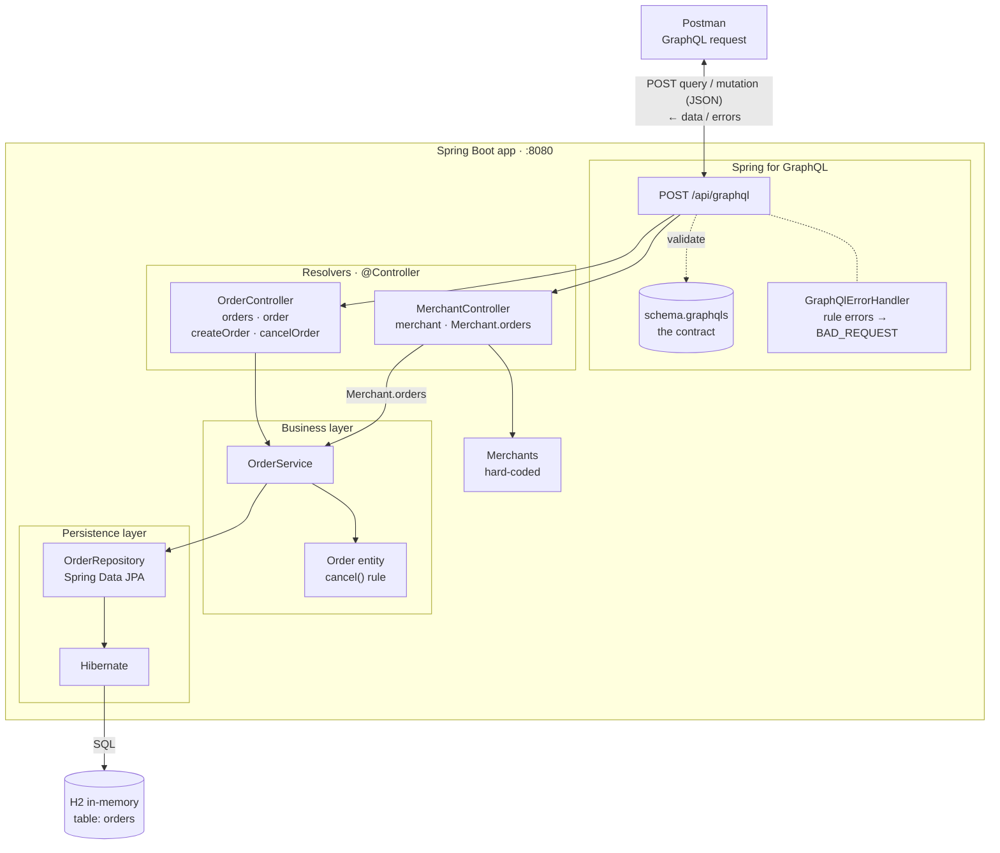

# Architecture Overview

A high-level view of `graphql-payments`, with Postman as the GraphQL client.

## How a request flows

1. **Introspection.** When you open a GraphQL request in Postman, it asks the endpoint for the schema. That's how Postman can list `orders`, `order`, `merchant`, `createOrder` and `cancelOrder`, and autocomplete their fields.
2. **Request.** Postman sends `POST /api/graphql` with a JSON body containing the `query` and its `variables`.
3. **Validation.** Spring for GraphQL checks the request against `schema.graphqls`. An invalid request is rejected with a `ValidationError`, and no Java code runs.
4. **Resolution.** Each requested field is routed to its `@QueryMapping`, `@MutationMapping` or `@SchemaMapping` method in a controller.
5. **Business rules.** `OrderService` loads, changes and saves orders. Rules such as "only `PENDING` orders can be cancelled" live in the `Order` entity.
6. **Persistence.** `OrderRepository` → Hibernate → H2. Merchants don't come from the database; they are hard-coded in `MerchantController`.
7. **Response.** Spring builds JSON with exactly the fields Postman asked for. Broken business rules come back in the `errors` array as `BAD_REQUEST`, via `GraphQlErrorHandler`.

## Layers at a glance

| Layer | Components | Responsibility |
|---|---|---|
| Client | Postman (GraphiQL and curl work the same way) | Sends GraphQL operations over HTTP |
| API | Spring for GraphQL, `schema.graphqls`, `GraphQlErrorHandler` | Contract, validation, routing, error formatting |
| Resolvers | `OrderController`, `MerchantController` | Map schema fields to Java methods; no business logic |
| Business | `OrderService`, `Order` entity | Rules and state changes |
| Persistence | `OrderRepository`, Hibernate | Load and save entities |
| Database | H2 in-memory | Stores orders; emptied on every restart |

For the detailed field-by-field mapping, see [SCHEMA.md](SCHEMA.md). For the concepts behind this design, see [THEORY.md](THEORY.md).
