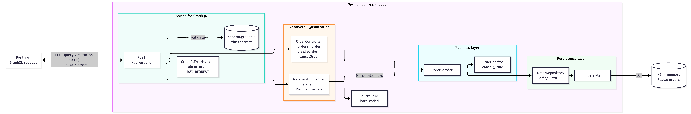

# GraphQL Payments

`graphql-payments` is a Spring Boot learning project for understanding GraphQL through a payments-style domain: merchants and their orders. It grows in phases, starting from an in-memory API and moving towards a containerised, database-backed service, while keeping the GraphQL contract stable.

**Current phase:** orders are stored in an embedded **H2** database through **Spring Data JPA**, behind a service and repository layer. Next: Docker.



## Technology stack

| | |
|---|---|
| Language | Java (17 toolchain) |
| Build | Gradle via the Gradle Wrapper (`./gradlew`) |
| Framework | Spring Boot 4.1 (Spring Web MVC) |
| API | Spring for GraphQL |
| Persistence | Spring Data JPA, Hibernate, H2 (in-memory) |
| Tests | JUnit 5, `GraphQlTester` |
| Package root | `org.corebaseit.graphqlpayments` |

## Quick start

```bash
./gradlew bootRun
```

| What | URL |
|---|---|
| GraphQL endpoint | `POST http://localhost:8080/api/graphql` |
| GraphiQL (browser client) | http://localhost:8080/graphiql?path=/api/graphql |

> **The database starts empty on every run.** There is no seed data, so create an order before querying. Restarting the app wipes all orders and resets IDs to `1`.

Create an order, then read it back:

```graphql
mutation {
  createOrder(input: { merchantReference: "ORDER-1", amount: 49.95, currency: "EUR" }) {
    id
    status
  }
}
```

```graphql
{
  orders { id merchantReference amount currency status }
}
```

Run the tests:

```bash
./gradlew test
```

Ready-to-run operations are in [`graphiql-queries.graphql`](graphiql-queries.graphql). Full instructions for the terminal, IntelliJ IDEA, GraphiQL, curl and Postman are in [TEST.md](TEST.md).

## The API

```graphql
type Query {
    order(id: ID!): Order
    orders: [Order!]!
    merchant(id: ID!): Merchant
}

type Mutation {
    createOrder(input: CreateOrderInput!): Order!
    cancelOrder(id: ID!): Order
}

type Order {
    id: ID!
    merchantReference: String!
    amount: Float!
    currency: String!
    status: OrderStatus!
}

type Merchant {
    id: ID!
    name: String!
    orders: [Order!]!
}

input CreateOrderInput {
    merchantId: ID
    merchantReference: String!
    amount: Float!
    currency: String!
}

enum OrderStatus {
    PENDING
    APPROVED
    DECLINED
    CANCELLED
}
```

### Rules

**Merchants** are hard-coded: `1` Corebase Shop, `2` Tech Store.

**`createOrder`** creates a `PENDING` order.

| `merchantId` | Result |
|---|---|
| Omitted | Merchant `1` |
| `"1"` or `"2"` | That merchant |
| Anything else | `BAD_REQUEST`: `Merchant <id> does not exist` |

**`cancelOrder`** never deletes an order. It changes the status and keeps the record.

| Current status | Result |
|---|---|
| `PENDING` | Becomes `CANCELLED` |
| `CANCELLED` | Unchanged (safe to retry) |
| `APPROVED` or `DECLINED` | `BAD_REQUEST`: `Order <id> cannot be cancelled because its status is <status>` |
| Order not found | `null` |

**`Merchant.orders`** is resolved by a separate `@SchemaMapping` method that runs only when the client selects `orders`:

```graphql
{
  merchant(id: "1") {
    name
    orders { id merchantReference status }
  }
}
```

## Project structure

```text
src/main/java/org/corebaseit/graphqlpayments/
├── GraphqlPaymentsApplication.java   entry point (@SpringBootApplication)
├── GraphQlErrorHandler.java          IllegalStateException → BAD_REQUEST GraphQL error
├── merchant/
│   ├── Merchant.java                 record: id, name
│   └── MerchantController.java       Query.merchant, Merchant.orders
└── order/
    ├── Order.java                    JPA entity (table "orders"), cancel() rule
    ├── OrderStatus.java              PENDING, APPROVED, DECLINED, CANCELLED
    ├── CreateOrderInput.java         input record
    ├── OrderController.java          orders, order, createOrder, cancelOrder
    ├── OrderService.java             business rules, merchant validation
    └── OrderRepository.java          Spring Data JPA repository

src/main/resources/
├── application.properties            endpoint path, GraphiQL
└── graphql/schema.graphqls           the API contract

src/test/java/org/corebaseit/graphqlpayments/
├── GraphqlPaymentsApplicationTests.java
└── order/
    ├── CancelOrderTests.java
    └── CreateOrderTests.java
```

A request flows through the layers like this:

```text
Client → POST /api/graphql → schema validation → @Controller resolver
       → OrderService → Order entity rules → OrderRepository → Hibernate → H2
```

## Documentation

| Document | Read it to… |
|---|---|
| [TEST.md](TEST.md) | Run and test the project (terminal, IntelliJ, GraphiQL, curl, Postman) |
| [ARCHITECTURE.md](ARCHITECTURE.md) | See the high-level architecture and how a request flows |
| [SCHEMA.md](SCHEMA.md) | Understand how each schema field maps to Java code, with diagrams |
| [ANNOTATIONS.md](ANNOTATIONS.md) | Learn what every annotation in the project does and why it's there |
| [ADD-OPERATION.md](ADD-OPERATION.md) | Add a new query or mutation, step by step |
| [THEORY.md](THEORY.md) | Learn the concepts: GraphQL, stamp coupling, where GraphQL fits in payments system design |
| [docs/01-in-memory-to-jpa-h2.md](docs/01-in-memory-to-jpa-h2.md) | See how and why phase 1 moved from in-memory lists to JPA and H2 |
| [INMEMORY-TO-DOCKER-MIGRATION.md](INMEMORY-TO-DOCKER-MIGRATION.md) | Follow the roadmap towards Docker and Kubernetes |

## Roadmap

| Phase | Status |
|---|---|
| 1. In-memory baseline: controllers own Java lists | Done |
| 2. JPA and H2: service and repository layer | **Done (current)** |
| 3. Docker: package and run as a container | Next |
| 4. Kubernetes: deployment, service, persistent volume | Planned |
| 5. PostgreSQL: production database, Flyway or Liquibase migrations | Planned |

### Known limitations

- **No persistence across restarts.** H2 runs in memory; file-backed H2 is planned with Docker.
- **Merchants are hard-coded in two places**, `MerchantController` and `OrderService.KNOWN_MERCHANT_IDS`, and must be kept in sync. They should become a `Merchant` entity.
- **No `merchants` list query yet.** Adding one with `orders` selected will cause the N+1 query problem; the fix is `@BatchMapping`.
- **No way to approve or decline orders** through the API, so the `cancelOrder` rejection path is covered only by tests.
- **No pagination, authentication or query limits.**

## Troubleshooting

**`Port 8080 was already in use`**: another instance is still running. Stop it in IntelliJ (red ■ in the Run window), or from a terminal:

```bash
lsof -ti tcp:8080 | xargs kill
```

More fixes are in [TEST.md](TEST.md#7-troubleshooting).
