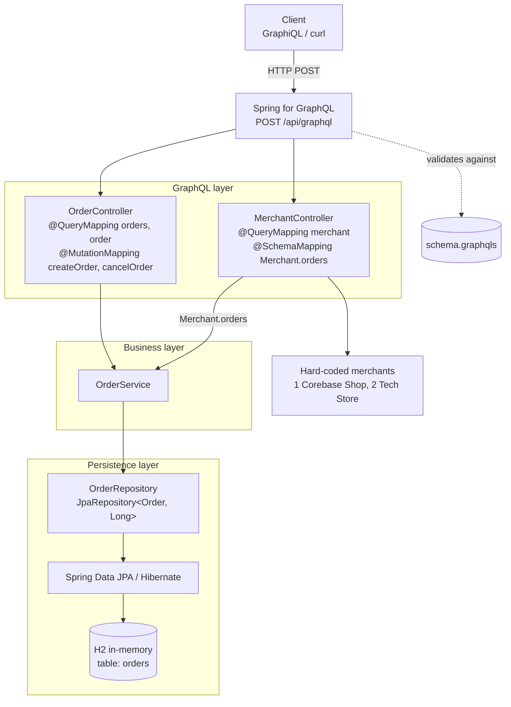
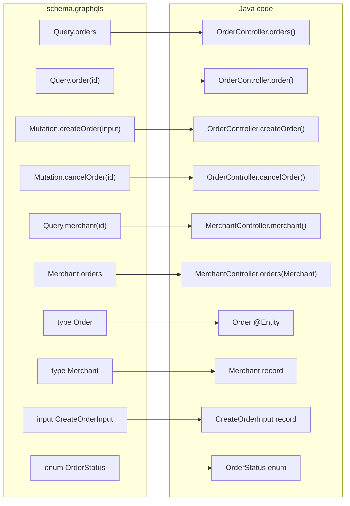
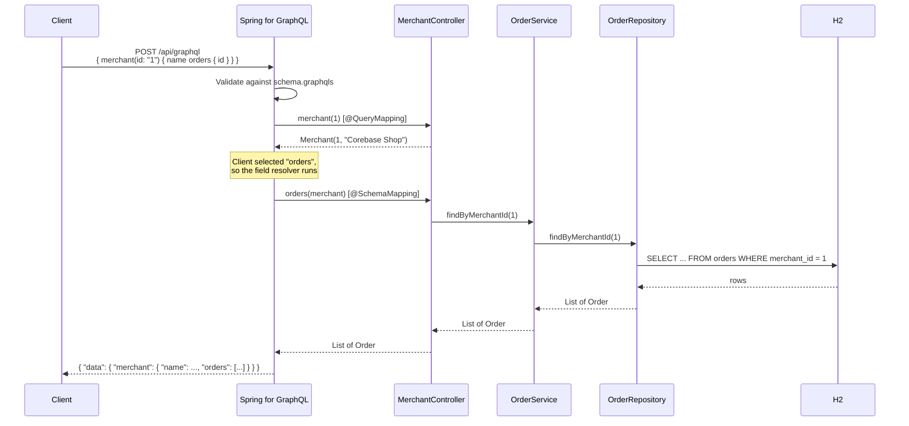

# GraphQL Schema and How It Maps to the Code

The GraphQL schema is the API contract: it defines what clients can ask for. The full API is the schema **plus** the Java resolvers that produce the data, served through a single HTTP endpoint.

| Part | What it does | In this project |
|---|---|---|
| **Schema** | Declares the operations, types, fields, and nullability | [`src/main/resources/graphql/schema.graphqls`](src/main/resources/graphql/schema.graphqls) |
| **Resolvers** | Java methods that return the data for each field | `@QueryMapping`, `@MutationMapping`, `@SchemaMapping` methods in `OrderController` and `MerchantController` |
| **Endpoint** | The single URL that receives every request | `POST /api/graphql` |

Spring for GraphQL loads every `.graphqls` file under `src/main/resources/graphql/` on startup. No property points to the file; its location is enough.

## 1. The schema

```graphql
type Query {
    order(id: ID!): Order
    orders: [Order!]!
    merchant(id: ID!): Merchant
}

type Mutation {
    createOrder(input: CreateOrderInput!): Order!
    cancelOrder(id: ID!): Order
}

type Order {
    id: ID!
    merchantReference: String!
    amount: Float!
    currency: String!
    status: OrderStatus!
}

type Merchant {
    id: ID!
    name: String!
    orders: [Order!]!
}

input CreateOrderInput {
    merchantReference: String!
    amount: Float!
    currency: String!
}

enum OrderStatus {
    PENDING
    APPROVED
    DECLINED
    CANCELLED
}
```

Nullability reminders:

| Notation | Meaning |
|---|---|
| `ID!` | Never null |
| `Order` | An `Order` or `null` (for example, `order(id: "999")` returns `null`) |
| `[Order!]!` | The list is never null and contains no null items; it can be empty |

## 2. Operations → resolver methods

Every field on `Query` and `Mutation` is matched by name to a controller method. The annotation tells Spring which root type the method belongs to.

| Schema field | Resolver | Calls | Data source |
|---|---|---|---|
| `Query.orders` | `OrderController.orders()` `@QueryMapping` | `OrderService.findAll()` | `OrderRepository.findAll()` → H2 |
| `Query.order(id)` | `OrderController.order(@Argument Long id)` `@QueryMapping` | `OrderService.findById(id)` | `OrderRepository.findById()` → H2 |
| `Mutation.createOrder(input)` | `OrderController.createOrder(@Argument CreateOrderInput input)` `@MutationMapping` | `OrderService.create(input)` | `OrderRepository.save()` → H2 |
| `Mutation.cancelOrder(id)` | `OrderController.cancelOrder(@Argument Long id)` `@MutationMapping` | `OrderService.cancel(id)` → `Order.cancel()` | `OrderRepository.findById()` + `save()` → H2 |
| `Query.merchant(id)` | `MerchantController.merchant(@Argument Long id)` `@QueryMapping` | — | Hard-coded in the controller (no database) |
| `Merchant.orders` | `MerchantController.orders(Merchant merchant)` `@SchemaMapping` | `OrderService.findByMerchantId(id)` | `OrderRepository.findByMerchantId()` → H2 |

`@Argument` binds GraphQL arguments to Java parameters and converts them: the GraphQL `ID` `"1"` becomes `Long 1`, and the `input` object becomes a `CreateOrderInput` record.

`createOrder` always assigns the new order to merchant `1` with status `PENDING` (see `OrderService.create`).

`cancelOrder` never deletes data: payments systems keep orders for audit, reconciliation and disputes. The rule lives in the entity, `Order.cancel()`:

- `PENDING` → `CANCELLED`.
- Already `CANCELLED` → unchanged, so a retried request is safe (idempotent).
- `APPROVED` or `DECLINED` → throws `IllegalStateException`. Undoing an approved payment is a void or refund, not a cancel.
- Unknown ID → the mutation returns `null`, which is why its return type is the nullable `Order`.

`GraphQlErrorHandler` (a `@ControllerAdvice` with a `@GraphQlExceptionHandler` method) turns that `IllegalStateException` into a GraphQL error with classification `BAD_REQUEST` and a readable message. Without it, Spring for GraphQL hides the message and returns a generic `INTERNAL_ERROR`.

## 3. Types → Java classes

| Schema type | Java type | How fields are resolved |
|---|---|---|
| `type Order` | `order.Order` (JPA `@Entity`, table `orders`) | Spring reads the getter with the matching name (`getId()`, `getAmount()`, …) |
| `type Merchant` | `merchant.Merchant` (record) | `id` and `name` come from record accessors; `orders` is not on the record, so the `@SchemaMapping` resolver supplies it |
| `input CreateOrderInput` | `order.CreateOrderInput` (record) | Bound from the request by `@Argument` |
| `enum OrderStatus` | `order.OrderStatus` (enum) | Matched by constant name; stored in H2 as text (`@Enumerated(EnumType.STRING)`) |

The schema and the Java types do not have to match one-to-one:

- `Order.merchantId` exists in Java but not in the schema, so clients cannot query it.
- `amount` is `Float` in the schema and `BigDecimal` in Java; Spring converts between them.
- `Merchant.orders` exists in the schema but not in the Java record; a field resolver fills the gap.

## 4. Configuration

| Setting | Effect |
|---|---|
| `src/main/resources/graphql/*.graphqls` | Schema files loaded automatically |
| `spring.graphql.http.path=/api/graphql` | The single GraphQL endpoint |
| `spring.graphql.graphiql.enabled=true` | Serves the GraphiQL UI at `/graphiql?path=/api/graphql` |

## 5. Request lifecycle

1. The client sends `POST /api/graphql` with a query and optional variables.
2. Spring for GraphQL parses the query and **validates it against the schema**. If it is invalid (unknown field, missing required argument, wrong type), the response contains a `ValidationError` and no Java code runs.
3. For each requested root field, Spring calls the matching `@QueryMapping` or `@MutationMapping` method.
4. The controller calls `OrderService` → `OrderRepository` (Spring Data JPA) → Hibernate → H2.
5. For each field selected on the returned objects, Spring reads the getter, or calls the `@SchemaMapping` resolver if one exists. A field resolver such as `Merchant.orders` runs **only** when the client requests that field.
6. Spring builds the JSON response containing exactly the fields the client selected.

## 6. Diagrams

### 6.1 Components and layers



### 6.2 Schema → Java mapping



### 6.3 Request: a merchant with its orders



If the client omits `orders` from the selection, the `@SchemaMapping` call and everything after it are skipped.

## 7. Changing the API

To add a field or operation:

1. Add it to `schema.graphqls`.
2. Make sure something resolves it: a getter with the same name on the Java type, or a new `@QueryMapping` / `@MutationMapping` / `@SchemaMapping` method.
3. Restart the app and check the field in GraphiQL's 📖 Docs panel.

A field declared in the schema with nothing to resolve it returns `null`. Spring for GraphQL checks the schema against the resolvers at startup and logs a warning for fields it cannot map. If the field is non-null (`!`), queries that request it fail.
