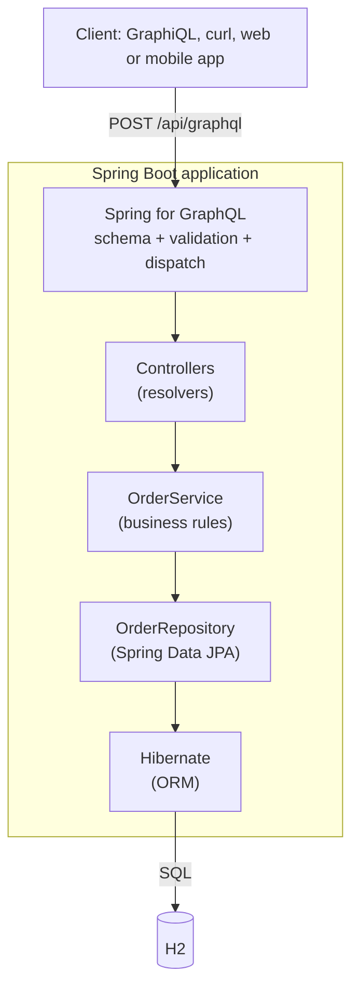
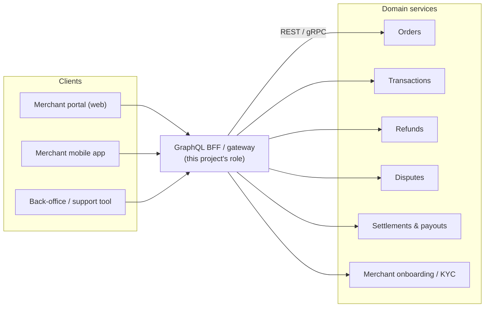

# GraphQL Payments: Theory Booklet

This booklet covers the ideas behind `graphql-payments`: why the project exists, what each part of the stack does, how the parts relate, what GraphQL changes about coupling between clients and servers, and where this kind of API fits in a larger payments system.

Companion documents:

| Document | Covers |
|---|---|
| [README.md](README.md) | Project overview |
| [TEST.md](TEST.md) | How to run and test the project |
| [SCHEMA.md](SCHEMA.md) | How the schema maps to the Java code, with diagrams |
| [docs/01-in-memory-to-jpa-h2.md](docs/01-in-memory-to-jpa-h2.md) | Phase 1: moving from in-memory lists to JPA and H2 |
| [INMEMORY-TO-DOCKER-MIGRATION.md](INMEMORY-TO-DOCKER-MIGRATION.md) | The roadmap towards Docker and Kubernetes |

---

## Part I: The project

### 1. Purpose

`graphql-payments` is a learning project. It uses a small payments domain, merchants and their orders, to study GraphQL on the JVM step by step, then grows the infrastructure underneath it one layer at a time.

The domain is kept small on purpose. There are two merchants, orders with a status, one query for a single order, one for the list, and one mutation to create an order. With so little domain logic, each architectural decision stays easy to see: what the schema promises, who resolves each field, where data lives, and what changes when storage changes.

The project moves in phases. Each phase must leave the GraphQL contract working:

1. **In-memory baseline:** controllers own Java lists. (Done.)
2. **JPA and H2:** a service and repository layer, with a database behind it. (Done: this is the current state.)
3. **Docker:** package and run the app as a container.
4. **Kubernetes:** run the container in a cluster.
5. **PostgreSQL:** compare with a production-grade database.

The GraphQL schema stays the same while the storage underneath changes completely. That is the first lesson of the project: **the API contract is independent of the implementation behind it.**

### 2. Domain model

| Concept | Meaning in payments | In this project |
|---|---|---|
| **Merchant** | A business that accepts payments | `Merchant` record, two hard-coded instances |
| **Order** | A purchase a merchant wants paid | `Order` JPA entity stored in H2 |
| **Merchant reference** | The merchant's own ID for the order, used for reconciliation | `merchantReference` field |
| **Amount and currency** | What is being charged | `BigDecimal amount`, `String currency` |
| **Status** | Where the order is in its lifecycle | `OrderStatus`: `PENDING`, `APPROVED`, `DECLINED` |

A real payments platform adds transactions, captures, refunds, chargebacks, settlements and payouts around the order. The model here is just enough to demonstrate one-to-many relationships (a merchant has orders), reads, writes and enumerations.

---

## Part II: The tech stack

### 3. Components

| Layer | Technology | Role |
|---|---|---|
| Language | Java (17 toolchain) | Records for immutable data, enums, the JPA entity |
| Build | Gradle with the Gradle Wrapper | Reproducible builds, `./gradlew bootRun`, `./gradlew test` |
| Application framework | Spring Boot 4.1 | Auto-configuration, embedded Tomcat, dependency injection |
| Web | Spring Web MVC | Serves HTTP; the GraphQL endpoint is one HTTP route |
| API | Spring for GraphQL (on GraphQL Java) | Loads the schema, validates requests, dispatches to resolvers |
| Persistence API | Jakarta Persistence (JPA) | Standard annotations: `@Entity`, `@Id`, `@Enumerated` |
| ORM | Hibernate | The JPA implementation: maps objects to tables and generates SQL |
| Repositories | Spring Data JPA | Generates `OrderRepository` from an interface and method names |
| Database | H2 (in-memory) | Embedded SQL database, created on startup, gone on shutdown |
| Dev client | GraphiQL | Browser IDE for the API, built from the schema |

### 4. How the layers relate



Each layer has one job and knows only about the layer below it:

- **Spring for GraphQL** knows the schema. It parses and validates each request and decides which resolver to call for each field. It does not know where data comes from.
- **Controllers** translate between GraphQL and the application. They take arguments, call the service, and return Java objects. They do not know about SQL or H2.
- **The service** holds business rules, for example "new orders start as `PENDING` and belong to merchant 1". It does not know about GraphQL.
- **The repository** hides how data is stored. `findByMerchantId` is just a method name; Spring Data turns it into a query.
- **Hibernate and H2** handle tables, rows and SQL.

Phase 1 showed why this split pays off. Swapping a Java `List` for a database changed the service and repository, but neither the schema nor any client query.

---

## Part III: GraphQL concepts

### 5. What GraphQL is

GraphQL is a query language for APIs plus a runtime that executes those queries against a typed schema. Facebook developed it in 2012 for its mobile apps and released it publicly in 2015. The GraphQL Foundation now maintains the specification.

Three ideas define it:

1. **A typed schema is the contract.** The server publishes every type, field, argument and whether each can be null. Clients and tools can read the schema (introspection), which is how GraphiQL offers autocomplete and documentation.
2. **The client chooses the shape of the response.** A query lists the fields it wants, and the response contains exactly those fields, nested the same way.
3. **One endpoint.** Every operation goes to the same URL (`/api/graphql` here). The operation inside the request body says what to do.

### 6. Building blocks

| Concept | Meaning | Example in this project |
|---|---|---|
| **Query** | Read operation | `orders`, `order(id)`, `merchant(id)` |
| **Mutation** | Write operation | `createOrder(input)` |
| **Subscription** | Long-lived stream of events | Not used yet |
| **Object type** | A shape with fields | `Order`, `Merchant` |
| **Input type** | A shape the client sends in | `CreateOrderInput` |
| **Scalar** | Leaf value | `ID`, `String`, `Float` |
| **Enum** | Closed set of values | `OrderStatus` |
| **Non-null (`!`)** | Value can never be null | `id: ID!` |
| **Variables** | Typed parameters sent separately from the query | `query FindOrder($id: ID!)` |
| **Resolver** | Code that produces the value of a field | `@QueryMapping`, `@SchemaMapping` methods |

### 7. Field resolution

GraphQL executes a query as a tree. It resolves the root field, then resolves each selected field on the result, then each selected field on those results, and so on.

In this project, `Merchant` is a record with only `id` and `name`, yet the schema offers `Merchant.orders`. The `@SchemaMapping` resolver in `MerchantController` supplies that field, and it runs **only when the client selects `orders`**. A query for `merchant { name }` never touches the orders table.

This is a key difference from returning a fixed object. The schema describes a graph of related data, and the client decides how far to walk it in each request.

### 8. GraphQL compared to REST and gRPC

| | REST | GraphQL | gRPC |
|---|---|---|---|
| Contract | URLs, verbs, and usually an OpenAPI document | Schema (SDL), enforced at runtime | Protobuf `.proto` files, compiled into code |
| Endpoint | One per resource | One for everything | One per service method |
| Response shape | Fixed by the server | Chosen by the client | Fixed by the message type |
| Fetching related data | Several calls, or custom endpoints | One request walking the graph | Several calls, or custom methods |
| HTTP caching | Natural (GET + URL) | Hard (POST, one URL) | Not applicable |
| Transport | HTTP/1.1 or HTTP/2, text (JSON) | HTTP, text (JSON) | HTTP/2, binary |
| Best at | Public resource APIs, simple CRUD, cacheable reads | Varied clients reading related data | Fast internal service-to-service calls |

None of these replaces the others. They solve different problems, and large systems often use all three.

---

## Part IV: Coupling, and how GraphQL reduces stamp coupling

### 9. Coupling levels

Coupling measures how much one module depends on the internals of another. Structured design (Stevens, Myers and Constantine, 1974) ranks coupling from loosest to tightest:

| Level | Modules share… |
|---|---|
| **Data coupling** | Only the individual values each one needs |
| **Stamp coupling** | A whole data structure, of which each uses only part |
| **Control coupling** | Flags that steer the other module's logic |
| **External coupling** | An externally imposed format or device |
| **Common coupling** | Global data |
| **Content coupling** | Each other's internals |

Data coupling is the goal. Stamp coupling is one step worse, and it's very common in APIs.

### 10. Stamp coupling in a typical REST API

Imagine a REST version of this project:

```http
GET /orders/1
```

```json
{
  "id": 1,
  "merchantId": 1,
  "merchantReference": "ORDER-10001",
  "amount": 49.95,
  "currency": "EUR",
  "status": "APPROVED",
  "createdAt": "...",
  "customer": { ... },
  "billingAddress": { ... },
  "riskScore": 12
}
```

A mobile app shows only the reference and the status, but it receives, parses and depends on the whole structure. That is stamp coupling:

- **The server can't tell what each client uses.** Every field is sent to every client, so removing or renaming any field might break someone. Fields pile up and are never removed.
- **The client is exposed to changes it doesn't care about.** A new nested object or a type change in an unused field can still break a strict deserializer.
- **Bandwidth is wasted** on data nobody reads (over-fetching). This matters most on mobile networks.
- **Teams work around it**, for example with `/orders/1?fields=...`, `/v2/orders/1`, or one endpoint per screen. Each of these adds more contract surface to maintain.

The opposite problem, under-fetching, adds another kind of coupling. To show a merchant and its orders, the client calls `/merchants/1` and then `/merchants/1/orders`. Now the client must know how resources link together and in what order to call them, so it's coupled to the server's resource layout.

### 11. How GraphQL moves APIs towards data coupling

With GraphQL, the mobile app sends:

```graphql
{
  order(id: "1") {
    merchantReference
    status
  }
}
```

and receives exactly those two fields. Several things change:

1. **Each client depends only on the fields it selects.** The contract between a particular client and the server is the selection set in its query, which is close to data coupling. Adding `riskScore` to `Order` changes nothing for this client.
2. **The server knows which fields are used.** Every request names its fields, so usage can be logged per field and per client. Retiring a field becomes a measured decision: mark it `@deprecated(reason: "...")`, watch usage drop to zero, then remove it.
3. **The API evolves without versions.** New fields and types are additive and invisible to existing queries, so there is no need for `/v2`. This is the evolution model most GraphQL APIs follow.
4. **Related data comes from one request.** `merchant { orders { ... } }` replaces two round trips. The client no longer encodes the call sequence or how resources link together.
5. **The internal model stays hidden.** `Order.merchantId` exists in the Java entity but not in the schema, so no client can come to depend on it. The schema is a deliberate public view, separate from the persistence model.

The same principle applies inside the server. The `Merchant` record doesn't carry a list of orders; `Merchant.orders` is resolved separately and only on demand. The merchant code isn't stamp-coupled to the order data either.

### 12. What GraphQL doesn't remove

Coupling doesn't disappear; it moves to the schema:

- Clients depend on **type names, field names and field meanings**. Renaming `merchantReference` still breaks every query that selects it.
- **Semantic changes** are invisible to the schema. If `amount` switches from major units (49.95) to minor units (4995), every query still validates and every client is now wrong.
- A careless schema can leak internals anyway. Exposing database IDs, table-shaped types or internal status codes just reproduces stamp coupling in GraphQL syntax.

GraphQL makes data coupling **possible and cheap**. Schema design still decides whether a given API gets there.

### 13. Other benefits

- **Self-documenting, typed contract:** introspection powers GraphiQL, code generators and IDE plugins. The documentation can't drift from the running code because it is the running code.
- **Validation before execution:** malformed requests are rejected against the schema before any resolver runs.
- **Strong client tooling:** clients such as Apollo Client and Relay cache objects by type and ID and can generate typed code from the schema.
- **Composition:** one schema can sit on top of many backend services (see Part V).
- **Faster frontend iteration:** a new screen often needs only a new query, without any backend change.

### 14. Costs and trade-offs

| Concern | What happens | Common mitigation |
|---|---|---|
| **N+1 queries** | A list of 50 merchants, each resolving `orders`, runs 1 + 50 database queries | Batch loading: `@BatchMapping` or a `DataLoader` in Spring for GraphQL |
| **HTTP caching** | Everything is a POST to one URL, so CDNs and browsers can't cache it | Persisted queries sent over GET; client-side normalized caches |
| **Expensive queries** | A client can ask for deeply nested or huge selections | Depth and complexity limits, timeouts, pagination, persisted query allow-lists |
| **Authorization** | Access must be checked per field and per object, not per URL | Authorize in the service layer; field-level checks for sensitive data |
| **Error handling** | Responses are usually HTTP 200, with errors in an `errors` array; partial data is possible | Monitoring must inspect response bodies, not just status codes |
| **Rate limiting** | One request can cost 1 or 10,000 units of work | Limit by computed query cost, not by request count |
| **Files and binary data** | Not part of the specification | Upload files over plain HTTP and pass a reference to GraphQL |
| **Learning curve** | New concepts, new tooling, schema governance | Start small, as this project does |

The N+1 problem is already latent in this project. There is no `merchants` list query today, but adding one and selecting `orders` would run one orders query per merchant. That makes it a good candidate for a future learning phase with `@BatchMapping`.

---

## Part V: GraphQL in system design

### 15. Where GraphQL fits

GraphQL works best at the **edge of a system, where varied clients read related data**. It is less suited to internal hot paths or event flows.

Typical placements:

**Backend for Frontend (BFF).** A GraphQL layer sits between user interfaces and backend services. Each screen asks for exactly what it shows. The BFF calls REST or gRPC services behind the scenes.

**API gateway with a federated graph.** Several teams each own a part of the schema (a subgraph), and a gateway composes them into one graph. Apollo Federation is the most widely used approach, and Spring for GraphQL can serve federated subgraphs. Clients see one API, while teams deploy independently.

**Aggregation over legacy systems.** A GraphQL schema can present a clean, modern model over older systems without rewriting them, and later implementations can replace the old ones behind the same schema.

**Public developer APIs.** Large platforms such as GitHub and Shopify offer GraphQL APIs to integrators, so each integration fetches only the data it needs.

### 16. A payments example



A merchant dashboard is the textbook case. One screen might show the merchant's profile, today's orders with their latest transaction status, open disputes, and the next payout. With REST, that is half a dozen calls to different services, each returning more than the screen needs. With GraphQL, it is one query against a (hypothetical) extended schema:

```graphql
{
  merchant(id: "1") {
    name
    orders(last: 10) { merchantReference amount currency status }
    openDisputes { id amount deadline }
    nextPayout { date amount currency }
  }
}
```

The mobile app requests a smaller version of the same graph, and the support tool a larger one, all against the same schema and with no endpoint written for any single screen.

Other good fits in payments:

- **Back-office and support tools** that need to look up a payment and everything around it (customer, refunds, disputes, risk) in one view.
- **Reporting and reconciliation screens** that filter and drill down into related data.
- **Partner and integrator APIs** where each partner needs a different subset of the data.

### 17. Where not to use GraphQL

| Use case | Better choice | Why |
|---|---|---|
| Card authorization path (terminal → acquirer → scheme) | ISO 8583 / scheme protocols, low-latency internal RPC | Fixed message formats, strict latency budgets, no use for flexible selection |
| Service-to-service calls inside the platform | gRPC or REST | Known, fixed contracts; binary efficiency; simpler operations |
| Event notifications to merchants | Webhooks | Push-based, retryable; the merchant doesn't poll |
| Internal event flows (payment captured, refund issued) | Message broker (Kafka, RabbitMQ) | Asynchronous, durable, decoupled in time |
| Bulk settlement and reconciliation files | Batch files (SFTP, object storage) | Large volumes, scheduled, often regulated formats |
| Simple public payment creation | REST with idempotency keys | Easy to cache and retry, and widely understood by integrators |

GraphQL mutations can create payments, but writes in payments need **idempotency**: a retried request must not charge twice. REST has well-known conventions for this, such as an `Idempotency-Key` header. In GraphQL you have to design it yourself, for example with an idempotency key field in the mutation input.

### 18. Production concerns this project will meet

The roadmap leads toward questions that a production GraphQL payments service must answer:

| Concern | Question | Phase where it appears |
|---|---|---|
| Persistence | Where does data live, and does it survive restarts? | Phase 1 (H2), phase 5 (PostgreSQL) |
| Packaging | How does the app ship and run identically everywhere? | Phase 3 (Docker) |
| Scaling | Can several instances run behind a load balancer? | Phase 4 (Kubernetes) |
| Schema migrations | How does the database schema evolve safely? | Phase 5 (Flyway or Liquibase) |
| Performance | How are N+1 queries avoided? | Future: `@BatchMapping` |
| Security | Who can read which merchant's data? | Future: Spring Security, per-merchant authorization |
| Abuse protection | How are expensive queries limited? | Future: depth and complexity limits |
| Pagination | How are large lists returned? | Future: cursor-based connections |
| Observability | How are slow fields and errors found? | Future: Micrometer metrics and tracing |
| Data sensitivity | Which fields must never appear in the schema? | Ongoing: PCI DSS scope (card numbers, CVV) |

---

## Part VI: Summary

- **The schema is the contract.** It describes what clients may ask for and is enforced on every request.
- **Resolvers implement the contract.** Spring for GraphQL maps schema fields to controller methods and getters, and runs field resolvers only when their fields are selected.
- **Layers keep change local.** Phase 1 replaced the whole storage model without any change to the API.
- **GraphQL reduces stamp coupling.** Clients depend only on the fields they select, servers can see exactly which fields are used, and the API evolves by adding fields instead of creating new versions.
- **Coupling moves into the schema, so schema design matters.** Field names and meanings become the shared contract.
- **GraphQL belongs at the edge of a system.** Use it for merchant portals, back-office tools and partner APIs. Keep authorization paths, internal service calls, events and bulk files on protocols built for them.

## Further reading

- GraphQL specification and learning guides: https://graphql.org
- Spring for GraphQL reference documentation: https://docs.spring.io/spring-graphql/reference/
- W. Stevens, G. Myers, L. Constantine, "Structured Design", *IBM Systems Journal*, 1974: the original description of coupling levels.
- Apollo Federation documentation: https://www.apollographql.com/docs/federation/
